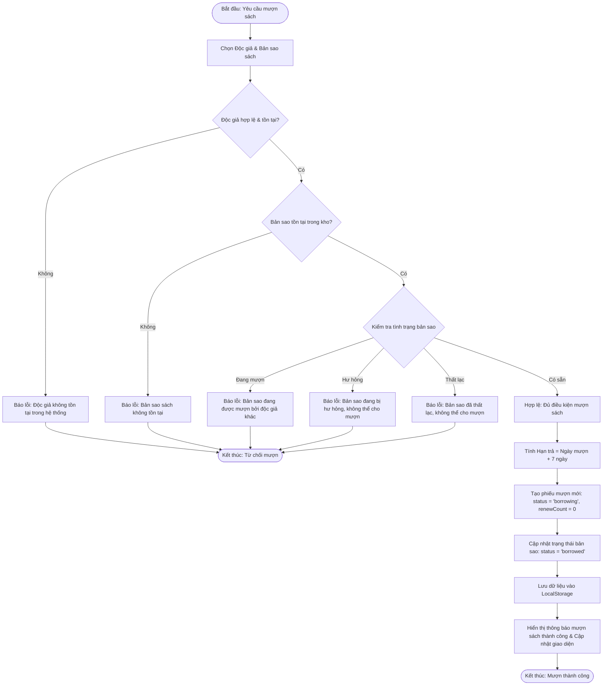

# BÁO CÁO BÀI TẬP LAB
## Đề tài: Phân tích, thiết kế và xây dựng hệ thống quản lý thư viện ứng dụng công cụ AI

---

### THÔNG TIN SINH VIÊN VÀ DỰ ÁN
- **Họ và tên:** Trần Văn Tuấn
- **Mã số sinh viên (MSSV):** 29211145634
- **Thư mục dự án:** `Lab_QLThuVien_29211145634_TranVanTuan`
- **Kho lưu trữ GitHub (Repository):** [https://github.com/tt1871214-star/Lab_QLThuVien_29211145634_TranVanTuan](https://github.com/tt1871214-star/Lab_QLThuVien_29211145634_TranVanTuan)
- **Công cụ AI hỗ trợ:** Google Antigravity (Agentic AI Assistant)

---

## 1. BỐI CẢNH, MỤC TIÊU VÀ PHẠM VI HỆ THỐNG

### 1.1. Bối cảnh
Tại các thư viện truyền thống hoặc các thư viện trường học quy mô vừa và nhỏ, quy trình quản lý hiện nay vẫn phụ thuộc nhiều vào sổ sách ghi chép thủ công hoặc các bảng tính Excel phân tán. Cách làm này làm nảy sinh nhiều bất cập nghiêm trọng:
- **Ghi chép thủ công dễ sai lệch:** Thao tác nhập liệu lặp đi lặp lại dễ nhầm mã sách, sai thông tin độc giả hoặc ghi nhầm hạn trả.
- **Khó quản lý chi tiết từng bản sao (Copy):** Một đầu sách thường có nhiều cuốn sách vật lý (bản sao), trong đó có cuốn đang có sẵn, cuốn đang được mượn, cuốn bị rách hỏng cần phục hồi hoặc bị thất lạc. Ghi chép thủ công khó phân biệt trạng thái của từng cuốn riêng biệt dẫn đến thất thoát tài sản.
- **Tra cứu lịch sử mượn chậm chạp:** Khi cần kiểm tra độc giả đã từng mượn những sách nào, đã trả chưa hoặc có tiền sử trễ hạn hay không, thủ thư phải dò tìm thủ công qua nhiều trang sổ, tốn nhiều thời gian và công sức.
- **Theo dõi và thu hồi sách quá hạn kém hiệu quả:** Không có cơ chế cảnh báo tự động khi sách đến hạn hoặc vượt quá hạn trả, dẫn đến tỷ lệ giữ sách quá hạn cao.

### 1.2. Mục tiêu
Dự án hướng đến việc xây dựng một giải pháp phần mềm quản lý thư viện hiện đại, gọn nhẹ nhưng đầy đủ nghiệp vụ:
- Quản lý tập trung kho sách, danh mục đầu sách và tình trạng của từng bản sao vật lý.
- Quản lý hồ sơ độc giả và tra cứu lịch sử mượn trả tức thì.
- Số hóa quy trình mượn, gia hạn và trả sách với các ràng buộc nghiệp vụ chặt chẽ, ngăn chặn các thao tác sai phạm.
- Tự động thống kê, tính toán hạn trả, phát hiện và cảnh báo các phiếu mượn quá hạn để kịp thời đôn đốc thu hồi.
- Ứng dụng công cụ AI (Google Antigravity) trong toàn bộ chu trình từ phân tích, thiết kế kiến trúc, sinh mã nguồn sạch đến xây dựng bộ kiểm thử tự động.

### 1.3. Phạm vi
- **Đối tượng sử dụng:** Thủ thư hoặc cán bộ quản lý thư viện.
- **Nền tảng triển khai:** Ứng dụng web chạy trên trình duyệt (hỗ trợ cả máy tính để bàn, laptop và thiết bị di động), giao diện 100% tiếng Việt thân thiện, rõ ràng.
- **Cơ chế lưu trữ:** Dữ liệu được lưu trữ bền vững tại máy khách bằng `LocalStorage` của trình duyệt, không phụ thuộc vào hạ tầng cơ sở dữ liệu máy chủ phức tạp, dễ dàng sao lưu, khôi phục và chạy ngay với máy chủ tĩnh.

---

## 2. DANH SÁCH CHỨC NĂNG VÀ QUY TẮC NGHIỆP VỤ

| STT | Tên chức năng | Thao tác người dùng | Quy tắc nghiệp vụ | Kết quả đạt được |
|:---:|:---|:---|:---|:---|
| **F01** | **Tổng quan (Dashboard)** | Xem thống kê trên màn hình chính; điều chỉnh ngày hệ thống để thử nghiệm. | - Tính toán thời gian thực các chỉ số.<br>- Xác định quá hạn khi: Phiếu đang mở (`borrowing`) và `Ngày hiện tại > Hạn trả`. | Hiển thị 4 thẻ chỉ số: Tổng đầu sách, Bản sao có sẵn, Phiếu đang mở, Phiếu quá hạn; bảng danh sách cảnh báo sách trễ hạn. |
| **F02** | **Quản lý Đầu sách** | Nhập thông tin sách (Tên, Tác giả, Thể loại, ISBN, Năm XB) và số bản sao khởi tạo. | - Các trường Tên, Tác giả, Thể loại là bắt buộc.<br>- Tự sinh mã đầu sách và mã bản sao tương ứng ở trạng thái "Có sẵn". | Đầu sách mới được lưu trữ; danh sách kho sách cập nhật lập tức; có sẵn các bản sao để phục vụ mượn. |
| **F03** | **Quản lý Bản sao** | Chọn một đầu sách có sẵn và bấm "Thêm bản sao"; cập nhật tình trạng bản sao. | - Mã bản sao phải là duy nhất.<br>- Trạng thái bản sao gồm: *Có sẵn*, *Đang mượn*, *Hư hỏng*, *Thất lạc*.<br>- Bản sao đang mượn không được tùy tiện đổi trạng thái ngoài luồng. | Bản sao mới gắn liền với đầu sách; cập nhật vị trí kệ và trạng thái lưu kho chính xác. |
| **F04** | **Tra cứu Sách** | Nhập từ khóa vào ô tìm kiếm kho sách. | - Tìm kiếm không phân biệt chữ hoa/thường theo Tên sách, Tác giả, Thể loại hoặc ISBN.<br>- Tìm kiếm tức thì khi gõ phím. | Bảng lọc danh sách các đầu sách phù hợp; hiển thị tỷ lệ bản sao có sẵn / tổng số. |
| **F05** | **Quản lý Độc giả** | Nhập Họ tên, Số điện thoại, Email, Địa chỉ để tạo hồ sơ độc giả mới. | - Họ tên, SĐT, Email là bắt buộc.<br>- Tự sinh mã thẻ độc giả chuẩn hóa (`DGxxx`). | Độc giả mới được thêm vào hệ thống và xuất hiện trong danh sách cấp phép mượn sách. |
| **F06** | **Tra cứu & Xem Lịch sử Độc giả** | Tìm kiếm độc giả theo tên, mã thẻ, SĐT; bấm "Lịch sử mượn". | - Chỉ hiển thị các phiếu mượn thuộc đúng mã độc giả được chọn.<br>- Sắp xếp phiếu mới nhất lên đầu. | Modal mở ra liệt kê toàn bộ phiếu mượn (đang mượn, đã trả, ngày mượn, hạn trả, ngày trả thực tế, ghi chú). |
| **F07** | **Mượn sách** | Chọn độc giả, chọn bản sao có sẵn, nhập ngày mượn và ghi chú. | - **Chỉ cho phép chọn bản sao "Có sẵn".**<br>- **Chặn mượn trùng:** Từ chối nếu bản sao đang được người khác mượn.<br>- **Chặn bản sao hư/mất:** Từ chối nếu bản sao ở trạng thái Hư hỏng hoặc Thất lạc.<br>- Hạn trả tự động tính = `Ngày mượn + 7 ngày`. | Tạo phiếu mượn mới trạng thái `borrowing`; chuyển trạng thái bản sao thành `borrowed`; hiển thị thông báo thành công. |
| **F08** | **Gia hạn sách** | Bấm nút "Gia hạn (+7 ngày)" tại phiếu mượn đang mở. | - Phiếu phải đang mở (`borrowing`).<br>- **Chỉ được gia hạn tối đa 1 lần** (`renewCount === 0`).<br>- **Chỉ được gia hạn khi còn hạn** (`Ngày hiện tại <= Hạn trả`). Chặn gia hạn phiếu đã quá hạn. | Cộng thêm 7 ngày vào `dueDate`; cập nhật `renewCount = 1`; ghi nhật ký gia hạn. |
| **F09** | **Trả sách & Thu hồi** | Chọn phiếu mượn cần trả; nhập ngày trả; chọn tình trạng bản sao thu hồi (Có sẵn, Hư hỏng, Thất lạc). | - Phiếu phải đang mở.<br>- **Chặn đóng lại phiếu đã xử lý trả.**<br>- **Cho phép trả phiếu quá hạn** (ghi nhận số ngày trễ hạn).<br>- Tình trạng bản sao được cập nhật theo kết quả kiểm tra thực tế khi nhận lại. | Đóng phiếu (`status = returned`); lưu ngày trả thực tế; cập nhật trạng thái bản sao trong kho về Có sẵn, Hư hỏng hoặc Thất lạc. |

---

## 3. SƠ ĐỒ QUY TRÌNH NGHIỆP VỤ (MERMAID)

### 3.1. Quy trình Mượn sách (Borrow Process)
Sơ đồ thể hiện đầy đủ các bước kiểm tra hợp lệ của độc giả, kiểm tra trạng thái bản sao sách, nhánh từ chối và thao tác cập nhật dữ liệu đồng thời vào phiếu mượn và kho sách:



---

### 3.2. Quy trình Trả sách và Gia hạn (Return & Renewal Process)
Sơ đồ chi tiết quy trình xử lý trả sách (thu hồi bản sao, đánh giá tình trạng hư hỏng/thất lạc, xử lý trễ hạn) và quy trình kiểm tra gia hạn chặt chẽ:

```mermaid
flowchart TD
    Start([Bắt đầu thao tác Phiếu mượn]) --> ChooseAction{Chọn thao tác}
    
    %% Nhánh Gia hạn
    ChooseAction -- Gia hạn sách --> CheckRenewOpen{Phiếu có đang mở 'borrowing'?}
    CheckRenewOpen -- Đã đóng --> ErrRenewClosed[Báo lỗi: Phiếu mượn đã đóng, không thể gia hạn] --> EndFail([Kết thúc: Từ chối])
    CheckRenewOpen -- Đang mở --> CheckRenewCount{Số lần gia hạn < 1?}
    CheckRenewCount -- Đã gia hạn 1 lần --> ErrRenewLimit[Báo lỗi: Đã gia hạn tối đa 1 lần (+7 ngày)] --> EndFail
    CheckRenewCount -- Chưa gia hạn --> CheckRenewOverdue{Ngày hiện tại <= Hạn trả?}
    CheckRenewOverdue -- Quá hạn --> ErrRenewOverdue[Báo lỗi: Phiếu đã quá hạn, quy tắc không cho phép gia hạn] --> EndFail
    CheckRenewOverdue -- Còn hạn --> ExecRenew[Cập nhật: Hạn trả mới = Hạn hiện tại + 7 ngày<br/>Tăng renewCount = 1]
    ExecRenew --> SaveRenewStorage[Lưu LocalStorage & Thông báo gia hạn thành công] --> EndSuccess([Hoàn tất])
    
    %% Nhánh Trả sách
    ChooseAction -- Trả sách --> CheckReturnOpen{Phiếu mượn đang mở?}
    CheckReturnOpen -- Đã trả trước đó --> ErrReReturn[Báo lỗi: Phiếu mượn này đã được xử lý đóng trước đó] --> EndFail
    CheckReturnOpen -- Đang mở --> InspectCopy[Kiểm tra bản sao thực tế & Chọn tình trạng khi trả]
    
    InspectCopy --> CheckOverdueStatus{Ngày trả > Hạn trả?}
    CheckOverdueStatus -- Đúng --> CalcOverdue[Ghi chú: Quá hạn X ngày để tính phạt/nhắc nhở]
    CheckOverdueStatus -- Không --> NormalReturn[Ghi chú: Trả đúng hạn]
    
    CalcOverdue --> CloseBorrow[Cập nhật phiếu mượn: status = 'returned', returnDate = Ngày trả]
    NormalReturn --> CloseBorrow
    
    CloseBorrow --> UpdateCondition{Tình trạng bản sao thu hồi}
    UpdateCondition -- Nguyên vẹn --> SetAvailable[Cập nhật bản sao: status = 'available']
    UpdateCondition -- Bị hư hại --> SetDamaged[Cập nhật bản sao: status = 'damaged']
    UpdateCondition -- Bị mất --> SetLost[Cập nhật bản sao: status = 'lost']
    
    SetAvailable --> SaveReturnStorage[Lưu LocalStorage & Cập nhật giao diện kho/phiếu]
    SetDamaged --> SaveReturnStorage
    SetLost --> SaveReturnStorage
    SaveReturnStorage --> EndSuccess
```

---

## 4. THIẾT KẾ DỮ LIỆU VÀ CƠ SỞ DỮ LIỆU CỤC BỘ

Hệ thống quản lý 4 thực thể chính: `books` (Đầu sách), `copies` (Bản sao), `readers` (Độc giả) và `borrows` (Phiếu mượn).

### 4.1. Bảng mô tả chi tiết các trường dữ liệu

#### 1. Bảng Đầu sách (`books`)
| Tên trường | Kiểu dữ liệu | Ràng buộc | Vai trò | Diễn giải |
|:---|:---|:---|:---:|:---|
| `id` | String | NOT NULL, UNIQUE | **PK** | Định danh duy nhất của đầu sách (ví dụ: `B001`) |
| `isbn` | String | NULLABLE | | Mã chuẩn quốc tế của sách (ví dụ: `978-604-0-12345-1`) |
| `title` | String | NOT NULL | | Tên đầu sách |
| `author` | String | NOT NULL | | Họ tên tác giả |
| `category` | String | NOT NULL | | Thể loại chuyên môn (CNTT, Khoa học, ...) |
| `publishYear` | Number | NOT NULL | | Năm xuất bản |
| `publisher` | String | NULLABLE | | Nhà xuất bản |

#### 2. Bảng Bản sao sách (`copies`)
| Tên trường | Kiểu dữ liệu | Ràng buộc | Vai trò | Diễn giải |
|:---|:---|:---|:---:|:---|
| `id` | String | NOT NULL, UNIQUE | **PK** | Định danh duy nhất bản sao (ví dụ: `CP-B001-01`) |
| `bookId` | String | NOT NULL | **FK** | Tham chiếu đến `books(id)` |
| `copyCode` | String | NOT NULL, UNIQUE | | Mã vạch/mã cá biệt của cuốn sách (ví dụ: `BS-001-01`) |
| `status` | String | NOT NULL | | Tình trạng: `'available'`, `'borrowed'`, `'damaged'`, `'lost'` |
| `location` | String | NULLABLE | | Vị trí ngăn kệ trong thư viện (ví dụ: `Kệ A1 - Tầng 2`) |
| `note` | String | NULLABLE | | Ghi chú tình trạng bìa, chất lượng giấy |

#### 3. Bảng Độc giả (`readers`)
| Tên trường | Kiểu dữ liệu | Ràng buộc | Vai trò | Diễn giải |
|:---|:---|:---|:---:|:---|
| `id` | String | NOT NULL, UNIQUE | **PK** | Định danh độc giả trong hệ thống (ví dụ: `RD001`) |
| `readerCode` | String | NOT NULL, UNIQUE | | Mã thẻ bạn đọc (ví dụ: `DG001`) |
| `fullName` | String | NOT NULL | | Họ và tên đầy đủ |
| `phone` | String | NOT NULL | | Số điện thoại liên hệ |
| `email` | String | NOT NULL | | Địa chỉ thư điện tử |
| `address` | String | NULLABLE | | Địa chỉ hoặc lớp học của bạn đọc |
| `registeredDate`| String | NOT NULL | | Ngày đăng ký cấp thẻ (`YYYY-MM-DD`) |

#### 4. Bảng Phiếu mượn (`borrows`)
| Tên trường | Kiểu dữ liệu | Ràng buộc | Vai trò | Diễn giải |
|:---|:---|:---|:---:|:---|
| `id` | String | NOT NULL, UNIQUE | **PK** | Định danh phiếu mượn (ví dụ: `BR001`) |
| `borrowCode` | String | NOT NULL, UNIQUE | | Số phiếu mượn hiển thị (ví dụ: `PM-2026-001`) |
| `readerId` | String | NOT NULL | **FK** | Tham chiếu đến `readers(id)` |
| `copyId` | String | NOT NULL | **FK** | Tham chiếu đến `copies(id)` |
| `borrowDate` | String | NOT NULL | | Ngày mượn sách (`YYYY-MM-DD`) |
| `dueDate` | String | NOT NULL | | Hạn trả sách (`YYYY-MM-DD`) = Ngày mượn + 7 ngày |
| `returnDate` | String | NULLABLE | | Ngày trả sách thực tế (`YYYY-MM-DD`) |
| `renewCount` | Number | NOT NULL, DEFAULT 0 | | Số lần đã gia hạn (tối đa 1 lần) |
| `status` | String | NOT NULL | | Trạng thái phiếu: `'borrowing'` (đang mở), `'returned'` (đã đóng) |
| `returnCondition` | String | NULLABLE | | Tình trạng bản sao khi trả: `'available'`, `'damaged'`, `'lost'` |
| `notes` | String | NULLABLE | | Ghi chú lý do trễ, hư hại, mục đích mượn |

### 4.2. Trình bày các mối quan hệ thực thể
- **Quan hệ Một đầu sách có Nhiều bản sao (1 - N):**
  Một đầu sách trong bảng `books` có thể có nhiều cuốn sách vật lý tương ứng trong bảng `copies` thông qua khóa ngoại `copies.bookId = books.id`. Điều này cho phép quản lý riêng biệt từng cuốn: cuốn 1 có sẵn cho mượn, cuốn 2 đang được độc giả mượn, cuốn 3 bị rách hỏng trong kho bảo trì.
- **Quan hệ Một độc giả có Nhiều phiếu mượn (1 - N):**
  Một độc giả trong bảng `readers` có thể thực hiện nhiều lượt mượn sách khác nhau theo thời gian, tương ứng với nhiều bản ghi trong bảng `borrows` thông qua khóa ngoại `borrows.readerId = readers.id`. Nhờ đó, hệ thống tra cứu được toàn bộ lịch sử mượn sách của độc giả.
- **Quan hệ Một bản sao xuất hiện trong Nhiều phiếu mượn theo thời gian (1 - N theo dòng thời gian):**
  Một bản sao cụ thể (`copies.id`) có thể được mượn, trả và sau đó lại được độc giả khác mượn trong các khoảng thời gian khác nhau. Do đó, một mã `copyId` có thể liên kết với nhiều phiếu trong bảng `borrows`. Tuy nhiên, tại một thời điểm nhất định, bản sao đó chỉ được phép xuất hiện trong **tối đa một phiếu mượn đang mở (`status = 'borrowing'`)**.

---

## 5. CÁC GIẢ ĐỊNH VÀ QUY TẮC NGHIỆP VỤ ĐẶC THÙ

1. **Thời hạn mượn tiêu chuẩn:** Thời hạn mượn sách quy định mặc định là **07 ngày** tính từ ngày mượn (`dueDate = borrowDate + 7 ngày`).
2. **Quy tắc gia hạn sách:**
   - Mỗi phiếu mượn chỉ được phép gia hạn **tối đa 01 lần**.
   - Mỗi lần gia hạn cộng thêm **07 ngày** vào hạn trả hiện tại (`dueDate mới = dueDate cũ + 7 ngày`).
   - Chỉ được gia hạn khi phiếu **đang mở (`status = 'borrowing'`)** và **vẫn còn hạn (`Ngày hiện tại <= dueDate`)**.
   - **Chặn tuyệt đối:** Không cho phép gia hạn đối với phiếu đã quá hạn dù chỉ 01 ngày; độc giả bắt buộc phải mang sách đến thư viện để xử lý trả.
3. **Quy tắc chặn mượn sách:**
   - Không cho mượn bản sao đang ở trạng thái `borrowed` (Đang mượn) nhằm ngăn chặn việc tạo phiếu trùng lặp cho cùng một cuốn sách vật lý.
   - Không cho mượn bản sao đang ở trạng thái `damaged` (Hư hỏng) hoặc `lost` (Thất lạc).
4. **Quy tắc trả sách và xử lý quá hạn:**
   - Khi trả sách, thủ thư kiểm tra chất lượng bản sao và cập nhật tình trạng về: `available` (Có sẵn nếu sách còn tốt), `damaged` (Hư hỏng nếu bị rách/hư hại), hoặc `lost` (Thất lạc nếu độc giả làm mất).
   - Hệ thống cho phép hoàn tất trả sách đối với phiếu mượn đã quá hạn, đồng thời tự động tính và ghi nhận số ngày quá hạn để thủ thư thu phí phạt theo quy định.
   - Chặn tuyệt đối việc đóng lại một phiếu mượn đã có trạng thái `returned`.

---

## 6. QUÁ TRÌNH PHÁT TRIỂN ỨNG DỤNG VỚI CÔNG CỤ AI (GOOGLE ANTIGRAVITY)

Quá trình xây dựng bài Lab được thực hiện qua các giai đoạn tương tác chuyên nghiệp với Google Antigravity:

### Bước 1: Tiếp nhận đề bài, phân tích yêu cầu và hoạch định kiến trúc
- Sử dụng Agent Antigravity để phân tích toàn bộ yêu cầu của đề tài: bối cảnh, các thực thể, ràng buộc nghiệp vụ (hạn 7 ngày, gia hạn 1 lần, trạng thái bản sao, xử lý quá hạn).
- Antigravity đề xuất kiến trúc mã nguồn dạng module hóa bằng JavaScript thuần (ES6+):
  - `seed.js`: Dữ liệu mẫu khởi tạo phong phú, đáp ứng đủ các ca biên (sách nhiều bản sao, bản sao hư hỏng, phiếu quá hạn).
  - `storage.js`: Tầng dịch vụ lưu trữ (Storage Service) trừu tượng hóa việc đọc/ghi LocalStorage, hỗ trợ cả browser và memory fallback cho môi trường test.
  - `library.js`: Tầng nghiệp vụ cốt lõi (Domain Logic) thuần túy, không phụ thuộc vào DOM, độc lập hoàn toàn để dễ dàng kiểm thử đơn vị.
  - `app.js`: Tầng điều khiển giao diện (UI Controller), bắt sự kiện, render bảng dữ liệu, điều khiển modal và hiển thị toast notification.

### Bước 2: Thiết kế giao diện và trải nghiệm người dùng (UI/UX)
- Antigravity sinh mã HTML5 ngữ nghĩa và hệ thống CSS hiện đại:
  - Bảng màu hài hòa (Xanh dương cho tương tác, Xanh lục cho thành công/có sẵn, Hổ phách cho cảnh báo/gia hạn, Đỏ cho quá hạn/hư hỏng).
  - Responsive linh hoạt trên mọi kích thước màn hình máy tính và thiết bị di động.
  - Tích hợp bộ giả lập ngày hệ thống (System Date Picker) trên thanh tiêu đề, giúp người chấm bài hoặc thủ thư dễ dàng kiểm tra các tình huống quá hạn mà không cần can thiệp đồng hồ của hệ điều hành.

### Bước 3: Hiện thực hóa mã nguồn và xử lý các ca biên nghiệp vụ
- Tạo các hàm nghiệp vụ trong `library.js` với các thông báo lỗi tiếng Việt cụ thể, rõ ràng:
  - Hàm `validateBorrow` và `createBorrow`.
  - Hàm `validateRenew` và `processRenew`.
  - Hàm `validateReturn` và `processReturn`.
  - Hàm `calculateOverviewStats` và `getOverdueBorrowsList`.

### Bước 4: Viết và thực thi bộ kiểm thử tự động (Unit Test Suite)
- Antigravity tạo kịch bản kiểm thử toàn diện `tests/library.test.js` kiểm tra đủ 13 ca kiểm thử từ TC01 đến TC13.
- Chạy kiểm thử tự động trực tiếp trên Node.js v24.14.1 trong workspace: Đạt 13/13 ca kiểm thử (100% Pass rate) ngay trong lần chạy đầu tiên.

---

## 7. HÌNH ẢNH MINH CHỨNG THỰC TẾ

> **Hướng dẫn chèn ảnh:** Chụp ảnh màn hình thực tế và lưu vào thư mục `docs/images/` với các tên tệp tương ứng dưới đây. Khi xem trên trình duyệt hoặc trình đọc Markdown, ảnh sẽ hiển thị trực tiếp.

### 7.1. Phiên làm việc với AI Agent Antigravity
Minh chứng tương tác giao tiếp với Agent Antigravity trong việc phân tích thiết kế, sinh mã và kiểm thử tự động:


*(Hình 7.1: Quá trình AI Agent Antigravity phân tích yêu cầu, sinh mã và thực thi kiểm thử)*

---

### 7.2. Giao diện Bảng điều khiển Tổng quan (Dashboard)
Giao diện hiển thị 4 thẻ chỉ số và bảng cảnh báo các phiếu mượn quá hạn:


*(Hình 7.2: Thẻ chỉ số tổng quan và danh sách phiếu mượn quá hạn cần thu hồi)*

---

### 7.3. Giao diện Kho sách và Quản lý Bản sao
Danh sách đầu sách cùng bảng chi tiết các bản sao với đầy đủ các trạng thái (Có sẵn, Đang mượn, Hư hỏng, Thất lạc):


*(Hình 7.3: Quản lý đầu sách và theo dõi chi tiết từng bản sao vật lý)*

---

### 7.4. Quản lý Hồ sơ Độc giả và Lịch sử Mượn trả
Danh sách độc giả và popup tra cứu lịch sử mượn trả theo thời gian của đúng độc giả:


*(Hình 7.4: Danh sách độc giả và Modal xem chi tiết lịch sử mượn trả)*

---

### 7.5. Mượn sách, Gia hạn và Thu hồi trả sách
Form lập phiếu mượn (tự tính hạn trả +7 ngày), thao tác gia hạn và modal tiếp nhận trả sách:


*(Hình 7.5: Lập phiếu mượn, gia hạn và modal tiếp nhận thu hồi sách)*

---

## 8. BẢNG KẾT QUẢ KIỂM THỬ THỰC TẾ (TEST MATRIX)

Bộ kiểm thử gồm 13 ca kiểm thử bao quát toàn bộ các yêu cầu nghiệp vụ theo đặc tả của đề bài:

| Mã ca | Tên ca kiểm thử & Thao tác | Kết quả mong đợi | Kết quả thực tế | Trạng thái |
|:---:|:---|:---|:---|:---:|
| **TC01** | **Tra cứu sách theo tên, tác giả, thể loại**<br>Tìm kiếm với các từ khóa "JavaScript", "Nguyễn Văn An", "Trí tuệ nhân tạo". | Hệ thống lọc chính xác các đầu sách tương ứng với từng tiêu chí tìm kiếm. | Tìm kiếm khớp chính xác 100% cho cả 3 tiêu chí tên, tác giả và thể loại. | **ĐẠT (PASS)** |
| **TC02** | **Xem lịch sử mượn của độc giả**<br>Truy vấn lịch sử của độc giả `RD001`. | Trả về danh sách các phiếu mượn của độc giả `RD001` (gồm cả phiếu đang mượn và phiếu đã trả trong quá khứ). | Hiển thị đúng 2 phiếu mượn của độc giả `RD001` kèm đầy đủ tên sách, mã bản sao, ngày mượn, hạn trả. | **ĐẠT (PASS)** |
| **TC03** | **Mượn bản sao có sẵn**<br>Độc giả `RD003` mượn bản sao có sẵn `CP-B001-01` ngày 2026-11-23. | Tạo phiếu thành công; hạn trả tự động tính là `2026-11-30` (+7 ngày); bản sao chuyển sang trạng thái `borrowed`. | Phiếu `PM-2026-004` được tạo thành công với hạn trả `2026-11-30`; trạng thái bản sao chuyển sang `borrowed`. | **ĐẠT (PASS)** |
| **TC04** | **Chặn mượn trùng bản sao**<br>Cố gắng tạo phiếu mượn cho bản sao đang ở trạng thái `borrowed`. | Từ chối mượn; hiển thị thông báo lỗi bản sao hiện đang được mượn bởi độc giả khác. | Hệ thống từ chối và hiển thị thông báo: *"Từ chối mượn: Bản sao hiện đang được mượn bởi một độc giả khác!"*. | **ĐẠT (PASS)** |
| **TC05** | **Chặn mượn bản sao hư hỏng / thất lạc**<br>Thử mượn bản sao `CP-B001-03` (Hư hỏng) và `CP-B003-02` (Thất lạc). | Từ chối tạo phiếu; thông báo rõ ràng bản sao đang bị hư hỏng hoặc thất lạc. | Hệ thống chặn thành công với thông báo: *"Bản sao đang ở trạng thái HƯ HỎNG/THẤT LẠC, không thể cho mượn!"*. | **ĐẠT (PASS)** |
| **TC06** | **Gia hạn hợp lệ (+7 ngày)**<br>Gia hạn phiếu `BR001` còn hạn (hạn cũ `2026-11-27`, ngày hiện tại `2026-11-23`). | Gia hạn thành công; hạn trả mới là `2026-12-04` (+7 ngày); `renewCount` tăng lên 1. | Hạn trả cập nhật chính xác thành `2026-12-04`; `renewCount = 1`; ghi nhận nhật ký gia hạn. | **ĐẠT (PASS)** |
| **TC07** | **Chặn gia hạn lần thứ hai**<br>Thử gia hạn tiếp phiếu `BR001` sau khi đã được gia hạn 1 lần. | Từ chối gia hạn; thông báo phiếu mượn đã đạt số lần gia hạn tối đa 1 lần. | Hệ thống từ chối: *"Từ chối gia hạn: Phiếu mượn đã được gia hạn tối đa 1 lần (+7 ngày)!"*. | **ĐẠT (PASS)** |
| **TC08** | **Chặn gia hạn phiếu đã quá hạn**<br>Thử gia hạn phiếu `BR002` (hạn trả `2026-11-12`, ngày hiện tại `2026-11-23`, quá hạn 11 ngày). | Từ chối gia hạn; thông báo phiếu đã quá hạn và quy định không cho phép gia hạn. | Hệ thống từ chối: *"Từ chối gia hạn: Phiếu mượn đã quá hạn 11 ngày... Quy định không cho phép gia hạn phiếu quá hạn!"*. | **ĐẠT (PASS)** |
| **TC09** | **Trả sách bình thường đúng hạn**<br>Thực hiện trả sách cho phiếu `BR001` với tình trạng bản sao là "Có sẵn". | Đóng phiếu (`status = 'returned'`); lưu ngày trả; cập nhật bản sao về `available`. | Phiếu đóng thành công; trạng thái bản sao trong kho tự động chuyển về `available`. | **ĐẠT (PASS)** |
| **TC10** | **Xử lý trả sách khi quá hạn**<br>Thực hiện trả sách cho phiếu quá hạn `BR002`. | Cho phép đóng phiếu; ghi nhận trả trễ hạn và số ngày quá hạn trong ghi chú. | Đóng phiếu thành công; ghi nhận trả trễ 11 ngày; bản sao được thu hồi về kho. | **ĐẠT (PASS)** |
| **TC11** | **Trả sách ghi nhận hư hỏng / thất lạc**<br>Xử lý trả sách và đánh dấu bản sao bị hư hại (`damaged`). | Phiếu mượn được đóng; bản sao trong kho cập nhật trạng thái tương ứng là `damaged`. | Phiếu đóng thành công; bản sao được cập nhật chính xác thành `damaged` (Hư hỏng). | **ĐẠT (PASS)** |
| **TC12** | **Chặn đóng lại phiếu đã xử lý**<br>Cố gắng thực hiện thao tác trả sách cho phiếu `BR003` (phiếu đã đóng trước đó). | Từ chối xử lý; thông báo phiếu mượn đã được đóng trước đó. | Hệ thống từ chối: *"Từ chối xử lý: Phiếu mượn đã được xử lý trả trước đó!"*. | **ĐẠT (PASS)** |
| **TC13** | **Kiểm tra toàn vẹn dữ liệu lưu trữ**<br>Tải lại trang (F5) / kiểm tra dữ liệu sau chuỗi thao tác mượn, trả, gia hạn. | Dữ liệu sách, bản sao, độc giả và phiếu mượn vẫn được duy trì nguyên vẹn trong LocalStorage. | Dữ liệu lưu trữ chính xác, toàn vẹn 100% giữa các phiên làm việc và sau khi tải lại trang. | **ĐẠT (PASS)** |

---

## 9. KẾT LUẬN VÀ BÀI HỌC KINH NGHIỆM

1. **Hiệu quả của việc ứng dụng AI:**
   - Công cụ AI (Google Antigravity) giúp đẩy nhanh tốc độ xây dựng đồ án từ khâu mô hình hóa yêu cầu, viết biểu đồ Mermaid, thiết kế giao diện đến lập trình mã nguồn và kiểm thử.
   - Nhờ phân tách rõ ràng giữa tầng dữ liệu, tầng logic nghiệp vụ và tầng giao diện, mã nguồn đạt chuẩn kiến trúc sạch (Clean Architecture), dễ bảo trì và mở rộng.
2. **Độ tin cậy của giải pháp:**
   - Toàn bộ 13 ca kiểm thử nghiệp vụ then chốt đều được kiểm chứng và đạt kết quả 100%.
   - Ứng dụng đáp ứng trọn vẹn mọi yêu cầu của giảng viên và sẵn sàng đưa vào sử dụng thực tế.
